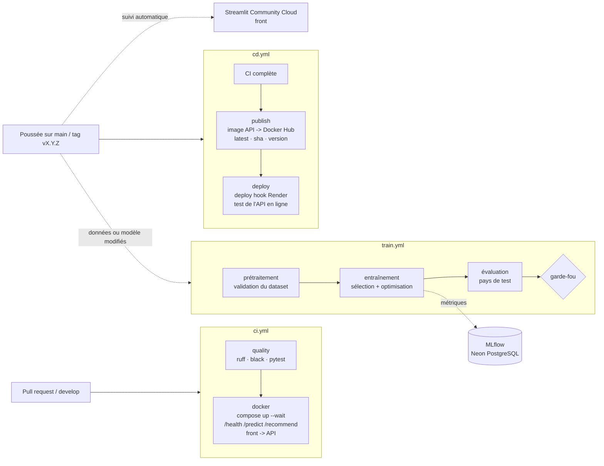

# Pipeline CI/CD et MLOps

Trois workflows GitHub Actions (`.github/workflows/`) :

| Workflow | Déclencheurs | Rôle |
|---|---|---|
| [`ci.yml`](../.github/workflows/ci.yml) | chaque *pull request*, chaque poussée sur `develop`, et appelé par `cd.yml` | **intégration continue** : qualité du code, tests, construction et test des images Docker |
| [`cd.yml`](../.github/workflows/cd.yml) | poussée sur `main`, tag `vX.Y.Z`, lancement manuel | **déploiement continu** : CI complète -> image de l'API sur Docker Hub -> déploiement Render -> test de l'API en ligne |
| [`train.yml`](../.github/workflows/train.yml) | lancement manuel, poussée sur `main` touchant les données ou le modèle | **pipeline MLOps** : prétraitement -> entraînement -> évaluation -> garde-fou, suivi dans MLflow (Neon) |

## Vue d'ensemble



### `ci.yml` – intégration continue

| Job | Contenu | Dépend de |
|---|---|---|
| `quality` | venv Poetry sur Python 3.11, `poetry check --lock`, installation (`ml`, `api`, `front`, `dev`), `ruff check`, `black --check`, `pytest --cov` | – |
| `docker` | `docker compose up --build --wait` (API + front), puis appels `/health`, `/predict`, `/recommend` et liaison front -> API | `quality` |

Une nouvelle poussée sur la même branche annule l'exécution précédente.

### `cd.yml` – déploiement continu (tests -> build -> déploiement)

| Job | Contenu | Dépend de |
|---|---|---|
| `ci` | **toute** la CI ci-dessus (workflow réutilisé) : rien n'est publié si un test échoue | – |
| `publish` | construit `api/Dockerfile` et pousse `docker.io/<utilisateur>/agritech-crop-api` avec les tags `latest` (main), `sha-xxxxxxx` et `X.Y.Z` (tag git `vX.Y.Z`) | `ci` |
| `deploy` | appelle le *deploy hook* Render (le service retélécharge `:latest`), attend le redémarrage, puis teste `/health` et `/recommend` sur l'URL publique | `publish` |

Deux déploiements ne tournent jamais en parallèle, et un déploiement en cours n'est jamais annulé.

**Front** : Streamlit Community Cloud est branché sur `main` (`frontend/app.py`, dépendances `frontend/requirements.txt`) et se redéploie tout seul à chaque poussée. L'adresse de l'API lui est donnée dans ses *secrets* (`API_URL`), sans rien écrire dans le code.

### `train.yml` – pipeline MLOps

`python -m agritech_crop_reco.pipeline` ([`pipeline.py`](../src/agritech_crop_reco/pipeline.py)) :

1. **Prétraitement** : validation du dataset consolidé versionné (clé unique, pas de valeur manquante, rendements > 0, gains dans [0, 1]). En local, `--from-raw` le reconstruit depuis `data/raw` et vérifie qu'il est **identique** au fichier versionné.
2. **Entraînement** : sélection (MLflow `agritech-crop-yield-01-selection`) puis optimisation (`agritech-crop-yield-02-optimisation`), sur les pays de test figés.
3. **Évaluation** : métriques sur les 21 pays de test.
4. **Garde-fou** : comparaison avec le modèle servi (`models/model_card.json`). **Échec** si le RMSE de test augmente de plus de 5 % ou si le classement des cultures (Spearman) baisse de plus de 0,02.

Le modèle candidat **ne remplace pas** le modèle servi : il est joint au run (artefact GitHub, 14 jours). Pour le promouvoir, on le réentraîne en local (`--output-dir models`), on relit, on commite. Les runs CI portent le tag MLflow `source=ci`.

## Notifications et logs en cas d'échec

- **E-mail GitHub** : un workflow en échec notifie automatiquement l'auteur du push (réglage personnel : *Settings -> Notifications -> Actions -> « Only notify for failed workflows »*).
- **Badges** du README : rouges dès qu'un workflow échoue sur sa branche.
- **Logs** : le job `docker` affiche les logs des conteneurs en cas d'échec ; le garde-fou et la publication écrivent un **résumé** lisible dans l'onglet du run (métriques, tags de l'image).
- Les étapes critiques **échouent bien** en cas d'erreur : `curl -f` (réponse HTTP en erreur), `--wait` (conteneur non sain), code de sortie 1 du garde-fou, secrets Docker Hub manquants.

## Configuration (une seule fois)

Aucun secret n'est écrit dans le dépôt. À créer dans GitHub : *Settings -> Secrets and variables -> Actions*.

| Nom | Type | Valeur | Utilisé par |
|---|---|---|---|
| `DOCKERHUB_USERNAME` | variable | identifiant Docker Hub (pas secret : il apparaît dans le nom de l'image) | `cd.yml` |
| `DOCKERHUB_TOKEN` | **secret** | jeton d'accès Docker Hub (*Account settings -> Personal access tokens*, droits *Read & Write*) | `cd.yml` |
| `RENDER_DEPLOY_HOOK_URL` | **secret** | URL du *deploy hook* du service Render (*Settings -> Deploy Hook*) | `cd.yml` |
| `API_PUBLIC_URL` | variable | URL publique de l'API, **sans `/` final** : `https://agritech-crop-api-latest.onrender.com` | `cd.yml` |
| `MLFLOW_TRACKING_URI` | **secret** | URL **directe** (pas `-pooler`) de la base Neon `mlflow`, copiée telle quelle : `postgresql://…/mlflow?sslmode=require` (pilote psycopg 3, par défaut dans SQLAlchemy 2.1) | `train.yml` |

Sans `RENDER_DEPLOY_HOOK_URL` ou `API_PUBLIC_URL`, l'image est publiée et l'étape correspondante est ignorée avec un avertissement. Sans `MLFLOW_TRACKING_URI`, le pipeline tourne sur une base SQLite éphémère.

**Render** : *New -> Web Service -> Existing image* `docker.io/<utilisateur>/agritech-crop-api:latest`, offre gratuite. Render fournit `PORT`, que le Dockerfile utilise. Le service se met en veille après inactivité : la première requête prend 30 à 60 s.

- Choisir **Existing Image**, pas le dépôt GitHub : sinon Render reconstruit le projet avec son Python par défaut (3.14) au lieu d'utiliser l'image testée par la CI.
- Les sous-domaines `onrender.com` sont **partagés entre tous les utilisateurs** : si le nom est déjà pris, Render ajoute un suffixe (ici `agritech-crop-api-latest`). Toujours copier l'URL affichée par Render ; `https://agritech-crop-api.onrender.com` appartient à un autre service. Le front le détecte : si `/health` ne répond pas comme l'API Agritech, il affiche « L'adresse configurée ne correspond pas à l'API Agritech ».

**Streamlit Community Cloud** : *Create app* -> dépôt `agritech-crop-reco`, branche `main`, fichier `frontend/app.py`, Python 3.11 (*Advanced settings*). Dans *Secrets* :

```toml
API_URL = "https://agritech-crop-api-latest.onrender.com"
```

Les secrets de premier niveau sont exposés comme variables d'environnement : `api_client.py` lit `API_URL` sans modification.

## Protection de `main`

Ruleset GitHub « CI main » (*Settings -> Rules -> Rulesets*), actif sur `main` : passage obligatoire par une *pull request*, contrôles **« Qualité (ruff, black, pytest) »** et **« Images Docker (API et front) »** au vert, suppression et réécriture d'historique interdites. Aucun outil (ex. Streamlit Cloud, qui propose d'ajouter un dossier `.devcontainer`) ne peut plus pousser directement sur `main`.

Ne pas exiger « CI / Qualité … » : c'est le nom du job quand **cd.yml** l'appelle, après le merge ; il n'est jamais rapporté sur une PR et la bloquerait indéfiniment.

## Ce que la CI suppose

- **Environnement Python** : en local, `poetry.toml` (`virtualenvs.create = false`) installe dans l'env conda actif. La CI n'a pas de conda : `POETRY_VIRTUALENVS_CREATE=true` y force un venv isolé basé sur le Python 3.11 de `setup-python` (sinon Poetry installerait dans le Python système du runner, en 3.14, et échouerait sur les paquets Debian).
- Le modèle (`models/`, < 1 Mo) et le dataset consolidé (`data/processed/`) sont **versionnés** : la CI n'a besoin d'aucune donnée brute.
- Après un changement de dépendances : `poetry lock`, puis régénérer `api/requirements.txt` et `frontend/requirements.txt` (voir le README). `poetry check --lock` fait échouer la CI si `poetry.lock` est périmé.

## Reproduire en local

```bash
poetry check --lock
ruff check . && black --check . && pytest --cov
docker compose up -d --build --wait            # puis http://127.0.0.1:8000/health et :8501
docker compose down
python -m agritech_crop_reco.pipeline --from-raw   # pipeline MLOps complet + garde-fou
```
